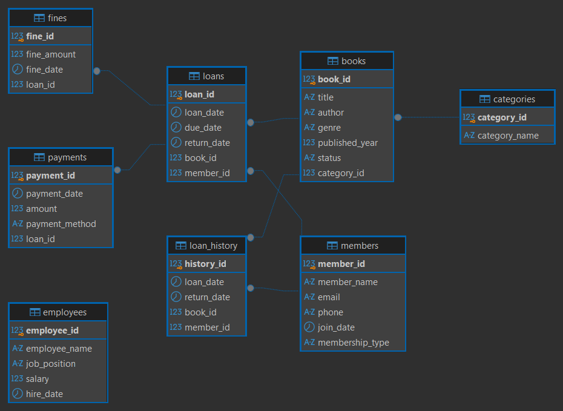

# Library Management System

## Overview

A relational database project built using **PostgreSQL** to manage and analyze library operations, including books, members, employees, loans, payments, and fines.

This project demonstrates relational database design, data integrity, table relationships, and analytical SQL queries using realistic library scenarios.

## Technologies Used

- PostgreSQL
- pgAdmin 4
- DBeaver
- SQL

## Database Structure

The database consists of **8 tables**:

| Table | Description |
|---|---|
| `members` | Stores member information and membership details |
| `employees` | Stores employee information |
| `categories` | Organizes books into categories |
| `books` | Stores book details and availability |
| `loans` | Tracks book borrowing and returns |
| `payments` | Records payments associated with loans |
| `fines` | Stores fines associated with loans |
| `loan_history` | Maintains historical borrowing records |

## Database Diagram

The Entity Relationship Diagram (ERD) illustrates the database tables, their primary and foreign keys, and the relationships between them.

## SQL Concepts Applied

- Relational database design
- Primary keys, foreign keys, and database constraints
- INNER JOIN, LEFT JOIN, and RIGHT JOIN
- GROUP BY and HAVING
- Aggregate functions: COUNT, SUM, AVG, and MAX
- Subqueries and correlated subqueries
- EXISTS and NOT EXISTS
- SEMI JOIN and ANTI JOIN patterns using EXISTS and NOT EXISTS
- CASE and COALESCE
- UNION and INTERSECT
- DISTINCT, ORDER BY, and NULL handling

## Project Files

| File | Description |
|---|---|
| `01_create_tables.sql` | Creates the database tables, relationships, and constraints |
| `02_insert_data.sql` | Inserts sample data into the tables |
| `03_queries.sql` | Contains SQL queries for data retrieval and analysis |
| `database_diagram.png` | Displays the database Entity Relationship Diagram |
| `README.md` | Project documentation |

## How to Run

1. Install PostgreSQL and pgAdmin 4.
2. Create a new database named `library Management System`.
3. Open the database's Query Tool in pgAdmin 4.
4. Execute the SQL files in the following order:
   - `01_create_tables.sql`
   - `02_insert_data.sql`
   - `03_queries.sql`

Run the analytical queries individually to view their results.

## Project Objectives

- Design a relational database for library operations.
- Establish table relationships and enforce data integrity.
- Analyze borrowing activity, book availability, payments, and fines.
- Practice intermediate SQL concepts through realistic queries.
- Visualize database relationships using an ERD.

## Future Improvements

- Explore Window Functions and other advanced SQL techniques.
- Integrate PostgreSQL with Python for data processing and analysis.